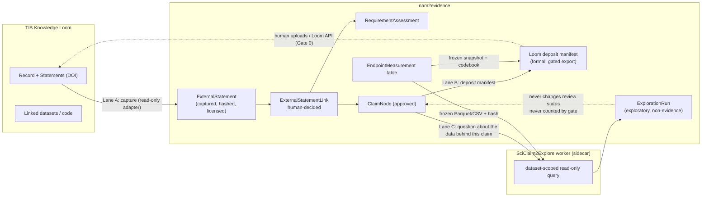

# Integration plan — nam2evidence × TIB Knowledge Loom × SciClaim2Explore

Status: **proposal, pre-implementation (Gate 0 not yet run)**
Last updated: 2026-10-30
Owner: nam2evidence maintainers
Related: [roadmap.md](roadmap.md), [REGULATORY_EVIDENCE_MODEL.md](../REGULATORY_EVIDENCE_MODEL.md),
[EXPORTS.md](../EXPORTS.md), ORAtlas epic
[dhuzard/oratlas#195](https://github.com/dhuzard/oratlas/issues/195) (federated evidence comparison:
Diggypaper + Knowledge Loom + SciClaim2Explore).

> **Positioning.** Nothing in this plan changes what nam2evidence claims to be. A Loom statement is
> *external, curated literature/data evidence*; a SciClaim2Explore result is *exploratory data
> exploration*. Neither is NAM validation, scientific verification, regulatory interpretation, or a
> human approval. All three stay distinct statuses, exactly as `docs/REGULATORY_POSITIONING.md`
> requires. No universal truth score, no silent semantic merging, no generated code executed in the
> API.

---

## 1. The three systems in one sentence each

| System | What it is | Unit of exchange | Who owns the truth |
|---|---|---|---|
| **nam2evidence** | Context-of-use-driven standardization and packaging of NAM-derived nonclinical data with human review gates. | Project → CoU → NAMStudy → EvidenceItem / EndpointMeasurement → ClaimNode → gated exports (JSON-LD, RO-Crate, …). | Producers own the data; named reviewers own approvals. |
| **TIB Knowledge Loom** | Open-science digital library (TIB, scientific contact Markus Stocker) that publishes *statements* grouped into *records*, each statement with its own DOI and explicit links to the data, code and analyses behind it; statements can be gathered into downloadable *evidence collections*. Open access, open source, free to publish. | Loom **record** (one work) → Loom **statements** (DOI each) → linked datasets/code/analyses. | Loom and the depositing authors. |
| **SciClaim2Explore** | Research tool (Ghaemi, Alizadehsani, Stocker, JCDL 2026, DOI 10.1145/3805696.3846517) built on the Loom: a user picks a *statement* and asks natural-language questions; the tool generates queries scoped to the dataset behind that statement, returns tables/visualizations, and shows how the result was produced. Scoping each question to the dataset of one finding removed wrong-dataset errors in the authors' evaluation. | **Exploration run**: question + source statement + scoped dataset + generated query + result + model/prompt provenance. | Nobody — the output is exploratory and unverified by construction. |

What we could **not** verify in this session (hosts outside the network allowlist): the Loom API
and export formats, the Loom licence terms, and whether SciClaim2Explore code is public. These
are Gate 0 items (§5).

---

## 2. Why integrate, concretely

Three gaps in nam2evidence today that the pair fills:

1. **Literature and public-data evidence has no first-class home.** The FDA 2026 profile requirements
   `FDA-NAM-BIO-00x` (human biological relevance) and `FDA-NAM-FIT-001` (comparison with established
   methods) are typically supported by *published* statements, not by the project's own endpoint
   rows. Today a `RequirementAssessment` can only link an `EvidenceItem`, and the evidence model doc
   explicitly leaves the door open: *"Future issues may add other canonical evidence types, but they
   must preserve the same project/CoU isolation and provenance guarantees."* Loom statements are the
   right first external type: DOI-identified, versioned, with declared data/code links.
2. **Reviewed packages leave nam2evidence as files, not as citable statements.** An approved claim with
   its supporting evidence, provenance and RO-Crate is exactly what a Loom statement is designed to
   publish. Depositing to the Loom gives each reviewed claim a DOI *and* makes its dataset
   discoverable, without nam2evidence ever asserting regulatory acceptance.
3. **Reviewers cannot interrogate the data behind a claim.** The Claim Graph shows claim text,
   confidence and evidence IDs; a reviewer who asks "what does the dose-response actually look like
   for the three donors?" has to open the CSV. SciClaim2Explore's pattern (question scoped to the
   dataset behind one statement) maps one-to-one onto "question scoped to the endpoint measurements
   behind one claim".

---

## 3. Integration lanes

### Lane A — Loom → nam2evidence: external statements as evidence (inbound)

A Loom statement enters a project as an **`ExternalStatement`**: an immutable capture, never a
rewrite. It can be linked, after a human decision, to a `RequirementAssessment` (via the existing
`RequirementEvidenceLink`) and, later, to a `ClaimNode` as context. It never becomes an
`EvidenceItem`, never becomes an `EndpointMeasurement`, and never satisfies the SHACL rule
"decision-informing claims must link validation evidence" on its own.

### Lane B — nam2evidence → Loom: deposit reviewed claims (outbound)

A **Loom deposit manifest** is a new *formal* export format (so it is subject to the
`ExportReadinessGate`): one Loom record per project snapshot, one statement per `approved` claim,
each statement carrying CoU, support level, limitations, supporting evidence IDs, and the checksum
of the frozen dataset (RO-Crate / Parquet) it rests on. nam2evidence produces the manifest; the
actual deposit is a separate, explicitly human-triggered step (manual upload until Gate 0 confirms
a Loom API and licence).

### Lane C — SciClaim2Explore pattern on the data behind a claim (local-first, optional)

An **exploration run** lets a reviewer ask a natural-language question about the endpoint
measurements behind one claim. An external worker (sidecar, same pattern as `services/validator`)
generates and executes a dataset-scoped, read-only, resource-limited query against a frozen
snapshot; nam2evidence stores question, query text, result hash, model/prompt versions and status.
The PHP API never executes generated SQL or code. Results are labelled *exploratory / not evidence*
and are invisible to the readiness scorer and the export gate.

---

## 4. Invariants (from AGENTS.md, restated for this integration)

| AGENTS.md invariant | How each lane honours it |
|---|---|
| Preserve raw value/file origin, provenance, candidate, human decision | `ExternalStatement` stores the raw Loom payload bytes + SHA-256, statement DOI/URI, record URI, capture time and Loom version. Links store who decided, when, why. Exploration runs store the dataset checksum, schema hash, query text and result hash. |
| Mapping suggestions require a human decision | `ExternalStatementLink` is born `suggested` (or `human_entered`) and only a reviewer with a recorded identity moves it to `approved`/`rejected`. No string- or LLM-similarity auto-acceptance. |
| Fail closed on blocking fields, source integrity, missing approval | Loom deposit manifest is a `FORMAL_FORMATS` member: blocked while the gate is closed. A statement with unknown licence or missing snapshot hash is `captured_unverified` and cannot be linked `supports`. A run whose dataset checksum does not match the current export is `stale` and cannot be displayed as current. |
| Keep normalization / scientific validity / evidence support / regulatory readiness distinct | New statuses are added, none merged: `ExternalStatement.captureStatus`, `ExternalStatementLink.relationship` + `reviewStatus`, `ExplorationRun.status`. None feeds `ReadinessScorer` dimensions or the gate. |
| Uploaded/extracted text is untrusted; protect restrictions and personal data | Loom statement text and SciClaim2Explore outputs are rendered as data, never as instructions. Licence/access scope is captured per statement; restricted statements are excluded from every export. No live external upload in CI; fixtures are synthetic. |

Trust rules adopted verbatim from ORAtlas #195 so the two repos stay interoperable:
*a shared DOI is not the same claim; identical text is not the same identity; p≥0.05 vs p<0.05 is
not a contradiction; same-cohort reuse is not independent replication; exploratory execution is not
scientific verification.*

---

## 5. Gate 0 — read-only feasibility (before any code)

Deliverable: `docs/integration/LOOM_SCICLAIM2EXPLORE_FEASIBILITY.md` + fixtures. No migrations, no
runtime code.

| # | Question | How to answer | Decision it unlocks |
|---|---|---|---|
| G0.1 | What does a Loom **record/statement** look like on the wire (JSON? JSON-LD? RDF? CSV via "evidence collection")? Is there a public read API or only HTML + DOI landing pages? | Inspect 2–3 public Loom records at `knowledgeloom.tib.eu`; save exact bytes + SHA-256 under `standards/fixtures/loom/` (public, CC-licensed only). | Adapter vs. manual-paste importer; which fields the crosswalk can fill. |
| G0.2 | **Licence and rights** of statements and linked datasets; attribution requirements for re-publication inside an RO-Crate. | Read Loom terms; record per-statement licence field name. | Whether statements may be embedded in exports or only referenced by DOI. |
| G0.3 | **Deposit path**: is there a write API / DOI minting workflow, what metadata is mandatory, can a dataset be attached or only linked, how are versions handled? | Loom documentation; contact TIB (Stocker). | Lane B scope: manifest-only vs. API deposit. |
| G0.4 | Is **SciClaim2Explore code** public (TIB GitLab/GitHub)? What is its input (statement URI → dataset) and output shape? | DOI 10.1145/3805696.3846517; TIB repositories; author contact. | Lane C: wrap their worker vs. implement the *pattern* with our own deterministic + optional-LLM worker. |
| G0.5 | **Field crosswalk** Loom statement ↔ nam2evidence, with an explicit loss/unknown/ambiguity report (same discipline as ORAtlas S0). | Write `standards/crosswalk/loom-statement-to-nam2evidence-v0.1.md`. | Entity field list for PR1. |
| G0.6 | Alignment with ORAtlas `ExternalEvidenceSource` and the SciClaim2Explore exchange contract from #195, so one fixture set serves both repos. | Diff field lists; agree on versioned JSON Schemas (`loom-statement-capture/0.1.0`, `exploration-run/0.1.0`). | Shared contract package location. |

Exit criterion: a signed-off feasibility doc with a go/no-go per lane. If G0.1/G0.3 show no
machine-readable path, Lane A ships as "paste/upload a Loom record export" and Lane B as
"manifest + human upload" — still useful, still safe.

---

## 6. Data model additions (api/, `App\Entity\NamCore`)

All new entities follow `NamCoreEntityTrait` conventions (ULID, project-scoped `ManyToOne`,
explicit columns, `extensions` JSONB only for genuinely open metadata) and write to `AuditLog`.

### 6.1 `ExternalStatement` (table `namcore_external_statement`)

| Field | Type | Notes |
|---|---|---|
| `project` | →Project | **required**; project isolation like every NAM-CORE entity. |
| `sourceSystem` | string(40) | `loom` for now; enum so Diggypaper/ORKG can follow. |
| `statementUri` | string(255) | **required**; Loom statement DOI/URI. Unique with `sourceVersion` per project. |
| `recordUri` | string(255) | Loom record URI (the work). |
| `originalWorkDoi` | string(255) | DOI of the underlying publication, if any. |
| `sourceVersion` | string(60) | Loom version / capture identifier. |
| `statementText` | text | **required**; verbatim. Rendered as data. |
| `statementKind` | string(30) | `author_claim \| curated_statement \| analytical_finding` — keeps the #195 epistemic units distinct. |
| `datasetLinks` / `codeLinks` / `analysisLinks` | json | Lists of `{uri, label, checksum?, licence?}`. |
| `studyContext` | json | Population/model, exposure, comparator, outcome, measurement/unit, time window, design — the #195 comparison fields. Filled by the crosswalk, left `null` when unknown; never guessed. |
| `uncertainty` | json | Whatever the source declares; no derived score. |
| `licence` / `accessScope` | string | `public \| restricted \| unknown`. `unknown` blocks `supports` links and all exports. |
| `rawPayload` | json | Exact captured payload. |
| `payloadSha256` | string(64) | **required**. |
| `capturedAt` / `capturedBy` | datetime / string | Who captured it (human or named adapter). |
| `captureStatus` | string(30) | `captured_unverified \| captured_verified \| superseded \| withdrawn`. |

### 6.2 `ExternalStatementLink` (table `namcore_external_statement_link`)

Explicit FKs, exactly one target set (DB check constraint):

| Field | Notes |
|---|---|
| `externalStatement` | →ExternalStatement (**required**) |
| `requirementAssessment` | →RequirementAssessment (nullable) |
| `claim` | →ClaimNode (nullable) |
| `evidenceItem` | →EvidenceItem (nullable) — for "this published statement contextualizes this matrix row". |
| `relationship` | `supports \| partially_supports \| contradicts \| contextualizes \| not_comparable` (reuses the `RequirementEvidenceLink` vocabulary + `not_comparable` from #195). |
| `linkOrigin` | `deterministic_rule \| machine_suggestion \| human_entered` (same vocabulary as `RequirementAssessment`). |
| `reviewStatus` | `suggested \| approved \| rejected` — mirrors `OntologyMapping`; only `approved` counts anywhere. |
| `reviewedBy` / `reviewedAt` / `reviewerNote` | Required when approving (422 otherwise, as for ontology approvals). |
| `comparabilityNote` | text — why the statement is or is not comparable to this CoU. |
| `provenance` | json |

Validation callbacks reject cross-project targets (statement project ≠ target project) exactly as
`RequirementEvidenceLink` does today.

Decision for maintainers: extend `RequirementEvidenceLink` with a nullable `externalStatement`
(the extension point the evidence-model doc anticipates) **or** keep the separate link entity above.
Recommendation: the separate entity, because it also targets claims and evidence items and keeps the
frozen v1 assessment serialization untouched.

### 6.3 `ExplorationRun` (table `namcore_exploration_run`) — Lane C only

| Field | Notes |
|---|---|
| `project`, `claim` | →Project, →ClaimNode (**required**) |
| `question` | text, verbatim |
| `datasetSnapshot` | json: export format, `sha256`, row count, schema hash, `supportingEvidenceIds` used to scope the rows |
| `analyticalUnit` / `variableMapping` | json (from the #195 exchange contract) |
| `queryText` | text — generated SQL, stored, never executed by the API |
| `workerName` / `workerVersion` / `modelName` / `promptVersion` | strings; `modelName` null for the deterministic template path |
| `status` | `requested \| running \| completed \| failed \| stale \| not_available` |
| `resultTable` | json (bounded, e.g. ≤ 2 000 cells) + `resultSha256` |
| `limitations` | json — worker-declared |
| `requestedBy` / `requestedAt` / `completedAt` | audit |
| `evidenceStatus` | constant `exploratory_not_evidence` (stored, so exports and UI cannot forget it) |

No FK from `ClaimNode`, `EvidenceItem` or `RequirementAssessment` *to* an `ExplorationRun`: a run
can cite a claim; nothing can cite a run as support.

---

## 7. API additions (`/api/v1`, additive; v1 field names stay frozen)

| Lane | Endpoint | Behaviour |
|---|---|---|
| A | `POST /projects/{id}/external-statements/import` | Body: `{source_system, payload | payload_url?, captured_by}`. Validates against `loom-statement-capture/0.1.0`, hashes raw bytes, upserts by `(project, statementUri, sourceVersion)` idempotently (same bytes → 200 replay, different bytes → 409, like the guidance-profile loader). Optional `suggest_links: true` returns **suggestions only** (deterministic: same DOI as a CoU `sourceReference`, same evidence domain keyword) — nothing persisted as approved. |
| A | `GET /projects/{id}/external-statements` | Filters: `capture_status`, `access_scope`, `statement_kind`. |
| A | `POST /projects/{id}/external-statement-links` / `PATCH …/{linkId}/approve|reject` | Approve requires `reviewed_by`; `supports` requires `accessScope=public` and `captureStatus=captured_verified`. Audit-logged with old/new values. |
| A | `GET /compare/contexts` (existing) | Adds `external_statements: {count, by_relationship}` per CoU row — counts only, no score, consistent with the "not a leaderboard" note. |
| B | `GET /projects/{id}/exports/loom-manifest` | Formal format (`ExportReadinessGate::FORMAL_FORMATS += 'loom-manifest'`). 409 with the gate's blockers while closed. Returns `loom-deposit-manifest/0.1.0` JSON: record metadata, one statement per `approved` claim, dataset descriptor with RO-Crate/Parquet checksums, licence, `deposit_status: "not_deposited"`, mandatory disclaimer text. |
| B | `POST /projects/{id}/loom-deposits` (Gate 0 dependent) | Records a human-declared deposit outcome (`statement_uri`s returned by Loom) against the manifest hash. Never called automatically. |
| C | `POST /projects/{id}/claims/{claimId}/exploration-runs` | Freezes input (export the scoped endpoint table, hash it), creates a `requested` run, hands it to the worker via `ExplorerSidecarClient` (same shape as `ValidatorSidecarClient`, env `EXPLORER_URL`). When unset → `status: not_available`, explicit, never silent. |
| C | `GET /projects/{id}/claims/{claimId}/exploration-runs` | List with `evidence_status: exploratory_not_evidence` on every row. |

Export serializations (`ProjectGraphBuilder`): `ExternalStatement` → `nam:ExternalStatement` with
`prov:wasDerivedFrom` = statement DOI and `dcterms:license`; approved links →
`nam:contextualizedBy` / `nam:externallySupportedBy` (new context terms, versioned in
`standards/context/nam-core.context.jsonld`). Exploration runs are **not** in the JSON-LD graph;
they appear only in the RO-Crate as `exploration-runs.json` under a `nam:exploratory` flag when the
operator opts in.

---

## 8. Worker (Lane C) — `services/explorer/`

Same packaging as `services/validator`: Flask app, Dockerfile, `test_app.py`, optional in
`docker-compose.yml`, enabled by `EXPLORER_URL`.

- **Input:** the frozen snapshot (Parquet or CSV-in-ZIP produced by the existing export path), its
  SHA-256, a schema/codebook, the claim text and supporting evidence IDs, the question.
- **Execution:** DuckDB (or sqlite) opened **read-only** on the snapshot; statement allow-list
  (`SELECT` only, no attach/copy/pragma), row/byte/time limits, no network.
- **Query generation, two tiers:**
  1. *Deterministic templates* (no model): "values of endpoint X by concentration and donor",
     "replicate CV per endpoint", "rows excluded and why". Enough for the demo and for CI.
  2. *Model-assisted* (off by default): SciClaim2Explore-style NL→SQL scoped to the codebook, with
     model name and prompt version recorded. If G0.4 yields their worker, wrap it behind the same
     contract instead of reimplementing.
- **Output:** `exploration-run/0.1.0` JSON: query text, result table (bounded), result hash,
  limitations, timestamps, `execution_status`. The worker never sees reviewer identities or audit
  entries.
- **Hard rule:** the PHP API only stores and displays; it never runs the query, never re-generates
  it, never turns a result into an `EvidenceItem`.

---

## 9. Frontend (`frontend/src/app/projects/[id]/…`)

| Screen | Change |
|---|---|
| New `external-evidence` tab (Sidebar item "External Statements") | Table of captured statements: DOI, kind, licence badge, capture status, raw-payload drawer. Link panel per statement with target picker (requirement / claim / evidence item), relationship, comparability note, approve/reject with reviewer field. Suggestions shown in a muted "suggested — needs your decision" style, same as the ontology workspace. |
| Claim Graph | "Context from published statements" list on a claim (approved links only), with a hard label *not validation evidence*. Below it, "Explore the data behind this claim" panel: question box, run list with status, SQL shown verbatim, result table, banner **Exploratory — not evidence, not counted by the review gate**. Hidden with an explicit "explorer not configured" note when `EXPLORER_URL` is unset. |
| Requirement assessments (Evidence Navigator) | Evidence-link list shows external statements alongside evidence items, each with source badge and relationship. |
| Compare page | New column: external statements count per CoU, no ranking. |
| Export Center | "Loom deposit manifest" button under *formal (gated)* with the gate's blockers surfaced; "what's included" text states that deposit is a separate human action. |

TypeScript stays strict; `npm run build` must stay green (CI).

---

## 10. Delivery sequence

| Stage | Scope | Exit criteria |
|---|---|---|
| **G0** | Feasibility doc, crosswalk, synthetic Loom fixtures, contract JSON Schemas agreed with ORAtlas #195. | Go/no-go per lane recorded; fixtures and schemas committed; no runtime change. |
| **PR1 — Lane A core** | `ExternalStatement`, `ExternalStatementLink`, migration `Version2026MMDD000001`, import + link endpoints, audit, semantic-validator rules (§11), unit + integration tests, `docs/EXTERNAL_STATEMENTS.md`. | A fixture Loom statement imports idempotently; a human approves one `supports` link on `FDA-NAM-FIT-001`; all negative tests pass. |
| **PR2 — Lane A surfaces** | JSON-LD/RO-Crate serialization, compare-page counts, External Statements tab, claim contextualization. | Exports show statements with DOI provenance; UI never shows a non-approved link as evidence. |
| **PR3 — Lane B** | `loom-manifest` formal export, dataset codebook (CSVW/Table Schema) added to RO-Crate so the dataset is explorable, deposit record endpoint (if G0.3 says yes), Export Center wiring. | Manifest refused while gate closed (test); manifest hash stable across two runs on the same data; manual deposit round-trip documented. |
| **PR4 — Lane C** | `services/explorer` worker (deterministic tier), `ExplorationRun`, endpoints, Claim Graph panel, model-assisted tier behind a flag. | A run on the demo claim returns a table with query + hashes; a run cannot alter claim status (test); unset `EXPLORER_URL` yields an explicit `not_available`. |
| **PR5 — Demo + QA** | COU-HEP-001 demo gains: one supporting Loom statement, one deliberately *not comparable* statement, one exploration run fixture; `docs/POC_DEMO_SCRIPT.md` step; CI fixture digests. | Demo script runs offline end to end; CI green on frontend build and PHPUnit with PostgreSQL. |

Lanes B and C are independent of each other and of ORAtlas S5/S6; neither blocks the other.

---

## 11. Validation and gate rules to add

Mirror in `SemanticValidator` (PHP) and `standards/shacl/nam-core-v0.1.ttl` (or a v0.2 shapes file):

| Rule | Severity |
|---|---|
| `ExternalStatementShape`: `statementUri`, `payloadSha256`, `licence/accessScope` present. | blocking for export inclusion |
| An approved `supports` link requires `captureStatus = captured_verified` and `accessScope = public`. | blocking |
| A decision-informing / potentially-pivotal claim with **only** external-statement links and no `EvidenceItem` support still fails `EvidenceClaimShape` (unchanged rule; test that external links do not satisfy it). | blocking |
| A `suggested` link that is older than N days is a warning ("decision pending"), never auto-resolved. | warning |
| `loom-manifest` export: every included claim `approved`, every included statement `public`, dataset checksum present, no `ExplorationRun` content unless explicitly opted in. | gate blocker |
| Exploration run: dataset `sha256` ≠ current export hash → `stale`, hidden from "current" views. | status only, never blocking |

`ReadinessScorer` gains **no** new dimension from these features. Rationale: the ten POC dimensions
measure standardization of the project's own data; external statements and explorations must not
inflate "AI-readiness".

---

## 12. Tests (negative cases first, per AGENTS.md)

- Import of the same Loom bytes twice → 200 replay; altered bytes with the same URI/version → 409.
- Link approval without `reviewed_by` → 422; approving `supports` on an `unknown`-licence statement → 422.
- Cross-project link (statement from project A, assessment from project B) → validation violation.
- Decision-informing claim supported only by external statements → semantic error persists; export gate stays closed.
- `GET …/exports/loom-manifest` with any `human_review_required` claim → 409 with blockers.
- Restricted (`accessScope=restricted`) statement never appears in JSON-LD, RO-Crate or manifest.
- Creating an exploration run leaves `ClaimNode.reviewStatus`, `EvidenceItem` rows and the gate result byte-identical.
- Worker: non-`SELECT` query text, `ATTACH`, `COPY`, or a path outside the snapshot → refused; row/time limits enforced (`services/explorer/test_app.py`).
- `EXPLORER_URL` unset → run recorded as `not_available`, API returns 200 with an explicit note (same convention as `shacl_sidecar.available=false`).
- Frontend: build + `tsc --noEmit` green.

PHPUnit runs need the CI PostgreSQL setup; do not report them as passing without exercising it.

---

## 13. Explicit non-goals

- No automatic acceptance of Loom statements as evidence, and no similarity-based auto-linking.
- No conversion of a Loom statement, an ORAtlas TRUST value, or a SciClaim2Explore result into a
  nam2evidence `status`, `confidence`, readiness point or gate decision.
- No execution of generated SQL, notebooks or LLM-produced code inside `api/`.
- No automatic deposit to the Loom; no claim that a Loom DOI implies review, validation or regulatory
  acceptance.
- No re-analysis or meta-analysis across projects; the Compare page stays descriptive.
- No ingestion of restricted full text or personal data; no live external calls in CI.

---

## 14. Open decisions for the maintainers

1. **Gate 0 access.** This session could not reach `knowledgeloom.tib.eu`, `zenodo.org`,
   `dl.acm.org` or `techxplore.com`; someone with normal network access (or those hosts added to
   the session allowlist) must run G0.1–G0.4.
2. **Link entity shape.** Separate `ExternalStatementLink` (recommended) vs. extending
   `RequirementEvidenceLink`.
3. **Lane B depth now.** Manifest-only (safe, ships in PR3) vs. API deposit (needs G0.3 and a TIB
   conversation).
4. **Lane C model tier.** Deterministic templates only for the POC, or enable the model-assisted
   tier behind a flag once the worker contract is frozen.
5. **Shared contracts with ORAtlas.** Where the versioned JSON Schemas live (this repo under
   `standards/contracts/`, ORAtlas, or a small shared repo) so #195 S5/S6 and this plan consume the
   same fixtures.

## Sources consulted

- ORAtlas epic #195 and program epic #199 (contracts, trust rules, stage model):
  https://github.com/dhuzard/oratlas/issues/195 · https://github.com/dhuzard/oratlas/issues/199
- ORAtlas docs at the current `main` checkout: `docs/cross-repo-evidence-lineage.md`,
  `docs/scientific-verification.md`, `docs/assessment-protocol-interoperability.md`,
  `docs/evidence-identity.md`, `CROSS_REPO_DEPENDENCIES.md`.
- TIB Knowledge Loom announcement (statement DOIs, records, evidence collections, open access/open
  source): https://idw-online.de/en/news865956 · https://knowledgeloom.tib.eu/
- SciClaim2Explore: Ghaemi, Alizadehsani, Stocker, *SciClaim2Explore: Claim-Guided Exploration of
  Scientific Data Evidence*, JCDL 2026, https://doi.org/10.1145/3805696.3846517; press summary
  https://techxplore.com/news/2026-10-ai-explore-scientific-tool.html
- nam2evidence: `docs/REGULATORY_EVIDENCE_MODEL.md`, `docs/FDA_NAM_2026_PROFILE.md`,
  `docs/EXPORTS.md`, `docs/VALIDATION_RULES.md`, `api/src/Controller/V1/IntegrationController.php`,
  `api/src/Controller/V1/ComparisonController.php`, `api/src/Service/Export/ExportReadinessGate.php`.
